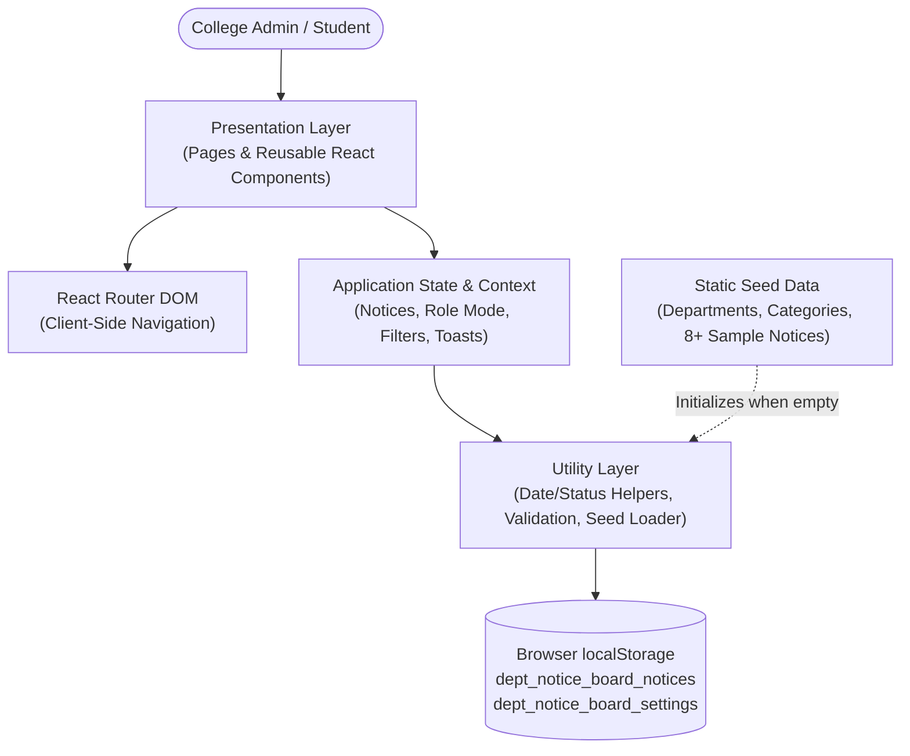
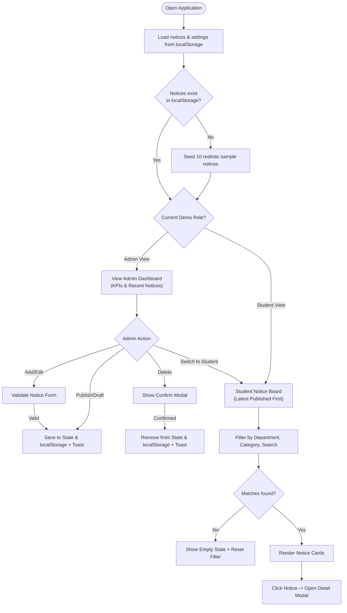

# Design Document: Department-Wise Digital Notice Board

---

## 1. Introduction

Communication within an academic institution relies heavily on timely, accurate, and accessible dissemination of information. Traditional physical notice boards mounted in college corridors often suffer from overcrowding, paper deterioration, limited visibility, and lack of department-specific organization. Students frequently miss critical updates regarding examinations, placement drives, workshops, and holidays because notices are buried under newer flyers or posted in distant blocks.

The **Department-Wise Digital Notice Board** is a modern, responsive, frontend-only React web application designed to digitize and streamline college notice management. By organizing announcements across academic departments and notice categories, and persisting data directly in the browser's `localStorage`, the system offers an intuitive platform for administrators to publish and manage notices and for students to filter, search, and read announcements relevant to their academic department.

---

## 2. Project Overview

The Department-Wise Digital Notice Board serves as a centralized academic bulletin portal for a college campus. Built purely on the client side using **React.js**, **JavaScript (ES6+)**, **HTML5**, and **CSS3**, the application demonstrates full Create, Read, Update, and Delete (CRUD) operations without requiring a backend server or external database.

Key highlights of the project include:
- **Dual-Mode Demonstration:** A front-end Role Switcher allowing seamless toggling between **Admin View** (management dashboard, notice creation, editing, deletion, expiry & priority controls) and **Student View** (read-only notice discovery, department/category filtering, keyword search, and detailed modal preview).
- **Department-Wise Organization:** Dedicated support for seven core engineering departments: **CSE**, **CSE (AI & ML)**, **IT**, **ECE**, **ME**, **CE**, and **EE** (plus campus-wide visibility where applicable).
- **Persistent Client-Side Storage:** Automatic synchronization with browser `localStorage`, seeded with realistic college notices so the application is immediately demonstrable and retains all user modifications across page refreshes.

---

## 3. Objectives

1. **Digitize Campus Announcements:** Replace cluttered physical notice boards with a clean, structured, and searchable digital interface.
2. **Departmental Relevance:** Enable students to immediately filter notices pertinent to their specific department (`CSE`, `CSE (AI & ML)`, `IT`, `ECE`, `ME`, `CE`, `EE`).
3. **Streamlined Administration:** Provide administrators with an insightful dashboard displaying notice metrics and rapid tools to publish, edit, prioritize, expire, or delete notices.
4. **Zero-Backend Portability:** Utilize `localStorage` for state persistence so the mini project can be demonstrated effortlessly on any modern browser without server setup.
5. **Professional UI/UX:** Deliver a cohesive, college-grade interface using a crisp blue, white, and light-grey palette, responsive layout, clean typography, toast feedback, and interactive modals.

---

## 4. Scope of the Project

### In Scope
- Frontend single-page application (SPA) built with React.js and React Router.
- Role simulation toggle (`Admin View` vs. `Student View`) for live demonstration.
- Complete notice CRUD lifecycle (Create, Read, Update, Delete) with form validation and delete confirmation dialogs.
- Filtering by Department, Category, Status (Active/Expired/Draft), Priority, and real-time keyword search.
- Automatic sorting of notices with the latest published notices appearing first.
- Dashboard analytics cards (Total Notices, Active Notices, Expired Notices, Total Departments, Recently Published Notices).
- Application settings (resetting demo data to default sample notices, clearing expired notices, default role/department preferences).

### Out of Scope
- Server-side database, REST/GraphQL APIs, or cloud storage.
- Cryptographic authentication, JWT tokens, or role-based access control enforced by a backend.
- Real-time push notifications, SMS/email dispatch, or multi-device synchronization across different browsers.
- File upload storage for large binary PDFs/images beyond lightweight metadata or client-side references.

---

## 5. Functional Requirements

| ID | Requirement | Description |
| :--- | :--- | :--- |
| **FR-01** | **Admin Dashboard Metrics** | Display counts for Total Notices, Active Notices, Expired Notices, Total Departments, and a list of Recently Published Notices. |
| **FR-02** | **Add & Publish Notice** | Allow admins to create a notice with title, description, department, category, priority, expiry date, author/issuer, and publish status (Published/Draft). |
| **FR-03** | **Form Validation** | Validate all required fields (Title, Description, Department, Category, Expiry Date) and display inline validation messages before submission. |
| **FR-04** | **Edit Notice** | Allow admins to modify any existing notice's fields, update its priority or expiry date, or publish a draft notice. |
| **FR-05** | **Delete Notice with Confirmation** | Prompt the admin with a confirmation modal before permanently deleting a notice. |
| **FR-06** | **Department Filtering** | Support filtering notices across all 7 departments (`CSE`, `CSE (AI & ML)`, `IT`, `ECE`, `ME`, `CE`, `EE`) and `All Departments`. |
| **FR-07** | **Category Filtering** | Support filtering by 6 categories: `Examination`, `Events`, `Holidays`, `Placements`, `Workshops`, and `General Announcements`. |
| **FR-08** | **Real-Time Search** | Filter notices instantaneously by matching keywords in the notice title, description, department, or issuer. |
| **FR-09** | **Notice Detail View** | Clicking any notice opens a clean detail modal/panel showing full content, metadata, priority badge, publish date, and expiry status. |
| **FR-10** | **Latest First Ordering** | Sort notices in reverse chronological order (newest published date first), with pinned/high-priority indicators clearly visible. |
| **FR-11** | **Role Switching** | Provide an interactive demo toggle between Admin View and Student View that dynamically adapts navigation and available actions. |
| **FR-12** | **Toast Notifications** | Show non-intrusive toast notifications for every key action (notice created, updated, deleted, published, role switched, data reset). |
| **FR-13** | **Empty State Handling** | Render helpful empty-state illustrations/messages with quick reset actions when search or filters yield zero notices. |
| **FR-14** | **Local Persistence** | Persist all notices and settings in `localStorage` so data survives browser refreshes; seed with at least 8 realistic sample notices on initial load. |

---

## 6. Non-Functional Requirements

- **Usability:** Intuitive sidebar navigation and clear visual hierarchy requiring zero user training.
- **Responsiveness:** Fluid layout adapting smoothly across desktop monitors, laptops, tablets, and mobile screens (with a collapsible mobile drawer sidebar).
- **Performance:** Instantaneous filtering, search, and route transitions (< 50 ms UI updates) using memoized React state and local storage.
- **Maintainability:** Modular component architecture with separated `components`, `pages`, `data`, and `utils` directories.
- **Reliability:** Graceful handling of corrupted or missing `localStorage` payloads via safe JSON parsing and automatic fallback to default seed notices.
- **Browser Compatibility:** Compatible with modern evergreen browsers (Google Chrome, Microsoft Edge, Mozilla Firefox, Safari).

---

## 7. Technology Stack

| Layer | Technology | Purpose |
| :--- | :--- | :--- |
| **UI Library** | React.js (v18+) | Component-based declarative user interface and state management |
| **Language** | JavaScript (ES6+) | Application logic, filtering, validation, and storage utilities |
| **Routing** | React Router DOM | Client-side navigation between Dashboard, Notices, Departments, Settings, and Student View |
| **Markup & Styling** | HTML5 & CSS3 | Semantic structure, CSS custom properties, Flexbox/Grid responsive layouts, and animations |
| **Icons** | Lucide React | Crisp, consistent vector iconography across navigation, cards, and actions |
| **Build Tool** | Vite | Fast local development server and optimized production bundling |
| **Persistence** | Browser `localStorage` | Client-side storage for notices and user preferences |

---

## 8. System Architecture (Frontend Only)

The application follows a layered client-side architecture where React UI pages and reusable components interact with centralized React Context/state hooks, which in turn synchronize with browser `localStorage`.



---

## 9. Module Description

### 9.1 Admin Dashboard Module
Provides an executive overview of campus notices. Displays four key KPI summary cards (**Total Notices**, **Active Notices**, **Expired Notices**, **Total Departments**), department-wise notice distribution breakdown, and a **Recently Published Notices** feed with quick view/edit actions.

### 9.2 Notice Management Module
Enables full CRUD operations:
- **Add Notice:** Form with Title, Department, Category, Priority (`High`, `Medium`, `Normal`), Expiry Date, Issuer Name, Status (`Published` or `Draft`), and Detailed Content.
- **Manage Notices:** Tabular/card management interface to edit existing notices, toggle publish status (Publish/Unpublish), inspect expiry state, and delete notices with a confirmation modal.

### 9.3 Department Management Module
Manages the 7 core academic departments (**CSE**, **CSE (AI & ML)**, **IT**, **ECE**, **ME**, **CE**, **EE**). Displays department cards with active notice counts, department codes, HOD/coordinator labels, and direct click-through filtering into that department's notice board.

### 9.4 Student Notice Board Module
A clean, distraction-free student-facing view focused on notice discovery. Features a prominent search bar, department pill/dropdown filter, category chips, priority badges, "Latest First" sorting, and an interactive Notice Detail Modal.

### 9.5 Notice Categories Module
Classifies notices into six standard academic categories (**Examination**, **Events**, **Holidays**, **Placements**, **Workshops**, **General Announcements**) with distinct color-coded badges and icons for rapid visual scanning.

### 9.6 Role Switching Module
A top-bar demo switcher allowing evaluators or users to toggle instantly between **Admin View** (full management access) and **Student View** (focused student notice experience), updating sidebar items and route guards accordingly.

### 9.7 Navigation & Settings Module
- **Sidebar Navigation:** Persistent left sidebar (collapsible on mobile) containing `Dashboard`, `All Notices`, `Department Notices`, `Add Notice`, `Manage Notices`, `Student View`, and `Settings`.
- **Settings:** Allows setting a preferred default department, toggling expired notice visibility in Student View, resetting notices back to default sample data, or purging expired notices.

---

## 10. UI/UX Design

### Visual Theme & Color Palette
- **Primary Brand Blue:** `#2563EB` (Royal Blue) and `#1E40AF` (Deep Academic Blue) for active navigation states, primary CTAs, and header accents.
- **Soft Blue Tint:** `#EFF6FF` and `#DBEAFE` for active badges, hover highlights, and subtle card accents.
- **Surfaces & Backgrounds:** `#F8FAFC` (Light Cool Grey) page canvas with crisp `#FFFFFF` elevated cards and `#E2E8F0` subtle borders.
- **Typography:** Clean sans-serif stack (`Inter`, `Plus Jakarta Sans`, system-ui) with clear typographic hierarchy (bold page titles, medium card headings, readable 14px–15px body text).
- **Status Semantics:**
  - *Active / Published:* Emerald Green (`#10B981` / `#ECFDF5`)
  - *High Priority / Urgent:* Rose Red (`#EF4444` / `#FEF2F2`)
  - *Expired / Warning:* Amber/Slate (`#F59E0B` / `#FFFBEB` or `#64748B` / `#F1F5F9`)
- **Micro-Interactions:** Smooth card lift on hover (`translateY(-2px)`), subtle shadow transitions, animated modal entry, and slide-in toast notifications.

---

## 11. Component Structure

```text
src/
├── assets/                 # Branding assets / SVG logo mark
├── components/
│   ├── ConfirmModal.jsx    # Reusable confirmation dialog for destructive actions
│   ├── EmptyState.jsx      # Clean empty state with icon, message, and reset CTA
│   ├── Header.jsx          # Top bar with page title, search/quick actions & Role Switcher
│   ├── NoticeCard.jsx      # Reusable card displaying notice summary, badges, and actions
│   ├── NoticeDetailModal.jsx # Full notice viewer modal with metadata and print/close actions
│   ├── NoticeForm.jsx      # Validated form used by Add Notice and Edit Notice flows
│   ├── Sidebar.jsx         # Responsive sidebar navigation adapting to Admin/Student role
│   ├── StatCard.jsx        # KPI summary card with icon, metric, and trend/subtext
│   └── ToastContainer.jsx  # Global toast notification stack
├── context/
│   └── NoticeContext.jsx   # Centralized state, CRUD actions, role toggle, and toasts
├── data/
│   └── sampleData.js       # 7 Departments, 6 Categories, and 10 realistic sample notices
├── pages/
│   ├── AddNoticePage.jsx   # Create or Edit notice page
│   ├── AllNoticesPage.jsx  # Searchable & filterable directory of all published/draft notices
│   ├── DashboardPage.jsx   # Admin KPI metrics, department summary & recent notices
│   ├── DepartmentsPage.jsx # Department cards & department-filtered notice explorer
│   ├── ManageNoticesPage.jsx # Admin management table with edit, publish & delete controls
│   ├── SettingsPage.jsx    # Demo preferences, reset sample data, clear expired notices
│   └── StudentViewPage.jsx # Dedicated student notice board with department & category filters
├── utils/
│   ├── dateUtils.js        # Date formatting, relative time, and expiry checks
│   └── storage.js          # Safe localStorage read/write/reset utilities
├── App.jsx                 # Layout shell and React Router route definitions
├── index.css               # Global theme tokens, utility classes, and responsive styles
└── main.jsx                # React DOM root mount
```

---

## 12. Data Storage Design (`localStorage`)

All persistent state is stored locally in the user's browser under deterministic keys:

1. **`dept_notice_board_notices_v1`** — JSON array of notice objects.
2. **`dept_notice_board_settings_v1`** — JSON object storing demo preferences (`role`, `defaultDepartment`, `showExpiredInStudentView`).

### Notice Object Schema

```json
{
  "id": "notice-101",
  "title": "End-Semester Theory Examination Schedule (Odd Semester)",
  "description": "Detailed timetable for B.Tech Odd Semester examinations...",
  "department": "CSE",
  "category": "Examination",
  "priority": "High",
  "status": "Published",
  "postedBy": "Controller of Examinations",
  "publishedAt": "2026-11-20T09:30:00.000Z",
  "expiryDate": "2026-12-20",
  "updatedAt": "2026-11-20T09:30:00.000Z"
}
```

### Derived Runtime States
- **Active Notice:** `status === "Published"` and `expiryDate >= today` (comparing local calendar date).
- **Expired Notice:** `expiryDate < today`.
- **Draft Notice:** `status === "Draft"`.

---

## 13. Application Workflow



---

## 14. Testing Strategy

Testing focuses on manual functional verification, UI responsiveness verification, and production build validation:
1. **CRUD Verification:** Create a new notice (valid and invalid inputs to verify form validation), edit an existing notice, toggle Draft/Published status, and delete a notice after confirming the modal.
2. **Persistence Testing:** Refresh the browser (`F5`) after creating, editing, and deleting notices to confirm `localStorage` retains every change.
3. **Filtering & Search Testing:** Verify each of the 7 departments, all 6 categories, keyword search matching, combined filters, and empty-state rendering.
4. **Expiry Logic Testing:** Verify notices with past expiry dates appear as `Expired` in Admin Dashboard/Manage Notices and are handled according to Student View settings.
5. **Role Switching Testing:** Toggle between `Admin View` and `Student View` and verify navigation menus, route protections, and available actions update immediately.
6. **Responsive & Visual Testing:** Inspect layout at desktop (`1280px+`), tablet (`768px`), and mobile (`375px`) viewports to ensure zero horizontal overflow and clean drawer navigation.

---

## 15. Limitations

- **Single-Browser Storage:** Because `localStorage` is local to a single browser profile on one device, notices created on one computer are not automatically visible on another device.
- **Demo Role Switching:** Role switching between Admin and Student is purely a client-side UI demonstration and does not provide real user authentication or security enforcement.
- **Storage Quota:** Browser `localStorage` is typically capped at ~5 MB per origin, making it suitable for text-based notices rather than large file attachments.

---

## 16. Future Enhancements

- **Backend & Database Integration:** Connect to a REST API (Node.js/Express + MongoDB or PostgreSQL) for multi-user campus-wide synchronization.
- **Role-Based Authentication:** Implement institutional SSO / JWT authentication for Faculty, HODs, Admins, and Students.
- **File & PDF Attachments:** Support uploading and previewing official circulars, exam timetables, and syllabus PDFs.
- **Real-Time Alerts:** Integrate WebSockets, email alerts, or push notifications for `High` priority notices.
- **QR Code Notice Sharing:** Generate scannable QR codes on physical campus displays linking directly to a specific digital notice.

---

## 17. Conclusion

The **Department-Wise Digital Notice Board** demonstrates how modern frontend web technologies can solve a real-world campus communication challenge effectively. With an intuitive blue-and-white dashboard aesthetic, organized department and category filtering, full client-side CRUD capabilities backed by `localStorage`, and seamless Admin/Student demonstration switching, the project provides a complete, polished, and demonstration-ready React mini project.
